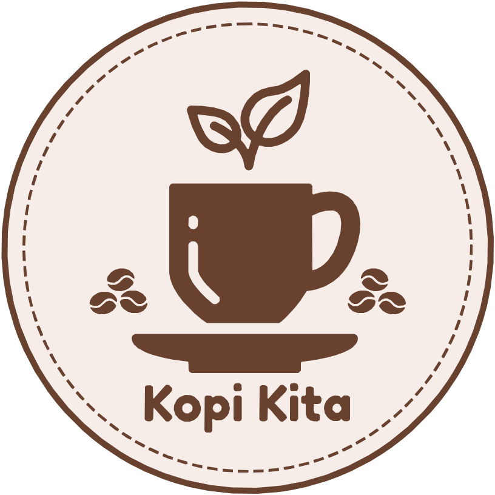

# Kopi Kita - Cafe Sales & Management System (Admin)



*Di setiap hirupan, ada cerita kita*

An **admin-only** web application for a small cafe. The admin monitors sales and orders, and manages the menu, loyalty customers, stock, suppliers, staff roster and reports, with interactive charts and popups on every page. Works in light or dark mode, on desktop and mobile.

**Live website:** https://nurdamia123.github.io/Kopi-Kita/
**Subject:** IMS566 Advanced Web Design Development and Content Management
**Programme:** CDIM262, UiTM Puncak Perdana
**Developer:** Nur Damia Izzati Binti Hassan (2025124987)

---

## How to test the login

This system has **one admin account** with a set password (hardcoded, no database). There is no register page.

| Username | Password |
|----------|----------|
| `Damia`  | `Kopikita123` |

- The username and password are **already filled in** on the login page - just click **Sign in**.
- To test the error message, change the password field to something wrong and click Sign in.
- A wrong username or password shows an error and how many attempts are left.
- After **5 wrong passwords** the login is locked for **30 seconds**.
- The admin can change the password in **Account settings** (top right menu). The new password is saved in the browser.

## Pages (8 HTML files)

| # | Page | File | What it does |
|---|------|------|--------------|
| 1 | Admin login | `index.html` | Username and password filled in automatically, show/hide password, Caps Lock warning, remember me, lock after 5 wrong tries |
| 2 | Dashboard | `dashboard.html` | 6 summary cards, 6 charts, low stock alert with restock, recent orders, "Today" popup after login |
| 3 | Orders | `orders.html` | Monitor all orders (view only - staff take orders at the counter): search, filters, pagination, 3 charts, receipt popup, CSV export |
| 4 | Menu | `menu.html` | 24 items with SVG photos, category filter, sort, 2 charts, item popup, add and delete items |
| 5 | Customers | `customers.html` | 30 loyalty members, tiers, 4 charts, profile popup with order history, CSV export |
| 6 | Inventory | `inventory.html` | Stock list, add / edit / delete items, restock, wastage adjustment, purchase orders (create, auto-create for low stock, receive, cancel), suppliers, stock history, 3 charts |
| 7 | Staff & Roster | `staff.html` | Team in grid or list view, add / edit / deactivate / delete staff, weekly shift roster with coverage check, payroll estimate with overtime, 4 charts |
| 8 | Reports | `reports.html` | Any date range, comparison with the previous period, monthly revenue target and projection, busy-times heatmap, automatic insights, sortable item performance table, CSV export, print |

## Features

- **Admin-only authentication** - one hardcoded admin account, clear error messages, login lock, change password with strength rules, login history. Every page is protected: it cannot be opened without logging in.
- **Light / dark mode** - switch with the moon/sun button in the top bar or in Account settings. The choice is remembered. Charts change colour too.
- **Popups everywhere** - click summary cards, charts, table rows, menu cards, staff cards or heatmap boxes to see complete details.
- **Lots of charts** - 27 Chart.js charts on the pages, plus more inside popups. All built from the sample data (meaningful, not random).
- **Full management functions (CRUD)** - menu items, stock items, purchase orders, staff and roster are all added, edited and deleted in the browser.
- **Lots of sample data** - 374 orders over the last 6 months (dates follow the real date), 24 menu items, 30 customers, 10 staff, 20 stock items, 15 suppliers, 8 purchase orders, 70 stock movements.
- **Data tools** - export CSV on every main page, backup to a .json file and restore it, reset to the original sample data.
- **Mobile friendly** - the sidebar becomes a slide-in menu, tables hide extra columns, popups open full screen on phones.
- **SVG images only** - logo, app icon, illustrations and all 24 menu photos are `.svg` (the photos were traced into vector shapes, no PNG/JPG inside). Avatars are drawn as SVG with initials.
- **Minimalist design** - off-white (or dark espresso) background, dark chocolate sidebar, one coffee-brown accent colour.

## Frameworks and libraries

| Library | Use |
|---------|-----|
| Bootstrap 5.3 | Responsive grid, navigation, modals (popups), tabs, forms, dark mode support |
| Bootstrap Icons 1.11 | Icons |
| Chart.js 4.4 | Interactive charts |
| Google Fonts (Inter) | Typography |
| HTML5, CSS3, JavaScript (ES6) | Pages, custom theme, all features |
| GitHub Pages | Hosting |

## Folder structure

```
kopikita/
├── index.html          (admin login)
├── dashboard.html
├── orders.html
├── menu.html
├── customers.html
├── inventory.html
├── staff.html
├── reports.html
├── README.md
├── brand/
│   ├── app-icon.svg             (app icon / favicon)
│   ├── kopikita_logo.svg        (round badge logo)
│   ├── kopikita_mark.svg        (cup + leaves only, for small sizes)
│   └── kopikita_mark_light.svg  (cream version for the dark sidebar)
├── css/
│   └── style.css       (minimalist theme, light and dark mode)
├── js/
│   ├── data.js         (sample data - the "database")
│   ├── db.js           (calculations + saving changes in the browser)
│   ├── app.js          (login, page guard, sidebar, footer, theme, settings, popups, chart helper)
│   └── pages/          (one script per page)
└── assets/img/         (illustrations + menu photos, all SVG)
```

## How to run

1. Open the folder in VS Code and use the **Live Server** extension, or
2. Open the live GitHub Pages link above in Google Chrome.

An internet connection is needed because Bootstrap, Bootstrap Icons, Chart.js and the Inter font load from a CDN.

## Notes

- This is a prototype. There is no real database; every change is saved in the browser only (localStorage). Use **Account settings > Data > Reset** to go back to the original sample data.
- "Today" in the system is the **real date** on the computer. The sample data (about 6 months of orders) moves forward automatically so the newest orders are always today, and the dashboard and reports are never empty.
- Food photos were taken from the internet (Pinterest) and converted to SVG for this academic prototype.

## Assignment requirements checklist

| Guideline / rubric item | Where it is in Kopi Kita |
|---|---|
| 3.1 Authentication with error feedback | `index.html` - hardcoded admin account, error message with attempts left, 30-second lock |
| 3.2 Navigation menu, responsive | Same sidebar on every page (`js/app.js`), slide-in menu on phones |
| 3.3 Dashboard with summary + visual | `dashboard.html` - 6 summary cards, 6 charts, low stock, recent orders |
| 3.4 Data view pages (min. 2) | Orders, Menu, Customers, Inventory, Staff (tables, grids, cards) |
| 3.5 Meaningful data visualisation | 27 Chart.js charts + heatmap built from the sample data; click to filter or open details |
| 4.1 Front-end framework | Bootstrap 5.3 |
| 4.2 Code organisation & comments | Separate `css/`, `js/`, `js/pages/`, `brand/`, `assets/img/`; every file has a header comment |
| 4.3 Responsive design | Bootstrap grid, mobile popups, hidden table columns, tested at 390px (phone) and 1366px (laptop) |
| 4.4 Content management | Page titles, meta description/keywords/author, Open Graph tags, headings and sections, footer |
| Footer | Logo, quick links, contact, developer details, GitHub link on every page after login (the login page is kept clean) |
| 8. Browser | Built and tested in Google Chrome |
